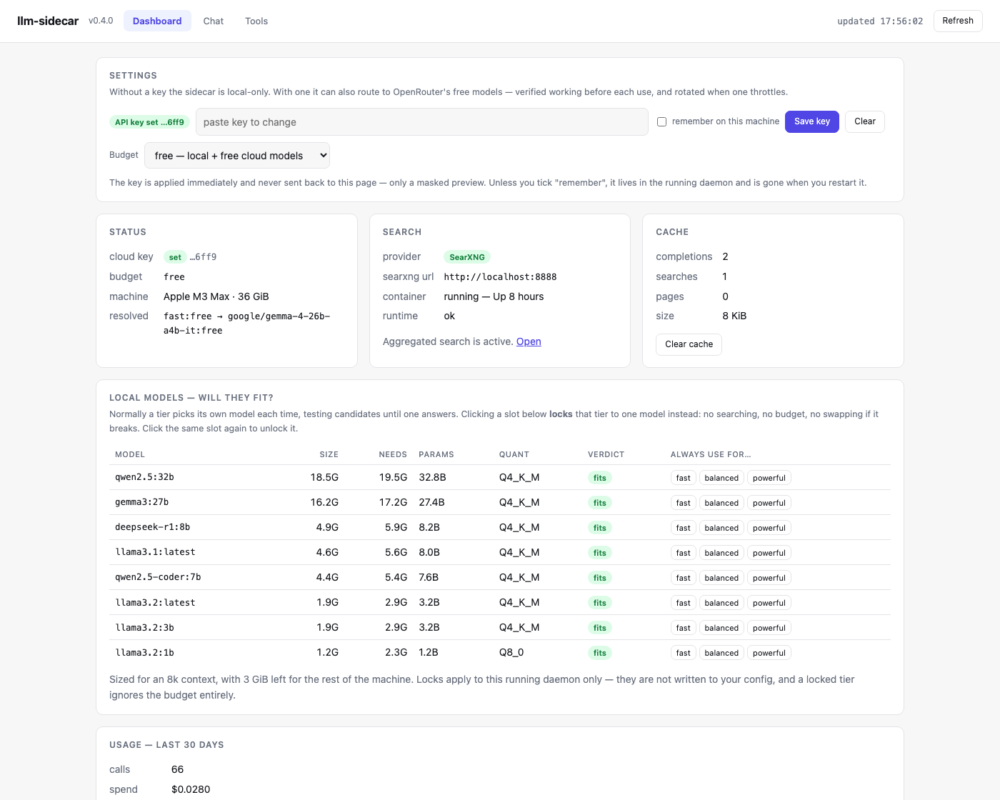

# llm-sidecar

<!-- mcp-name: io.github.awaistechnologist/llm-sidecar -->

[](https://github.com/awaistechnologist/llm-sidecar/actions/workflows/test.yml)
[](https://pypi.org/project/llm-sidecar/)
[](https://pypi.org/project/llm-sidecar/)
[](LICENSE)

**A local sidecar that gives every tool on your machine grounded, cited, routed AI — and never asks you which model to use.**

One process. It picks a working model, searches the web, reads pages, checks
facts, and tells you what everything cost. Works with **no API key at all** if
you have [Ollama](https://ollama.com); works better with one.

```console
$ llm-sidecar answer "What is Iran's population?"
As of mid-2026, Iran's population is estimated at 93,168,497 (Worldometer,
based on UN 2024 Revision). The 2025 estimate from Wikipedia is 92,417,681.

Caveat: Sources differ by year and methodology: Worldometer (2026 mid-year)
gives 93.17 million; Wikipedia (2025 est.) gives 92.42 million.

Sources:
  · https://en.wikipedia.org/wiki/Demographics_of_Iran
  · https://www.worldometers.info/world-population/iran-population/
```

That came from the live web, not training data, and it says where it got it —
including that the sources disagree. Ask something the web can't settle and it
tells you, instead of guessing.

It is not instant: a grounded answer means a search, two or three page fetches
and a model call, so expect tens of seconds — more on free models, which are
slow and sometimes have to be rotated past.

> **Status: early (0.6.0).** The API may still move. Extracted from
> [Agora](https://github.com/awaistechnologist/agora), where the routing and
> verification were originally built and proven.

---

## Install

```bash
brew install pipx
pipx ensurepath
exec $SHELL
pipx install llm-sidecar
```

On Linux use `apt install pipx` instead of brew. That is the whole install —
no extras to remember, every door works.

The third line matters: `pipx ensurepath` edits your shell config, and cannot
change a shell that is already running. `exec $SHELL` reloads it. Without that
you get `command not found: llm-sidecar` even though the install succeeded.

Add an OpenRouter key if you want free cloud models. Without one it runs
entirely on [Ollama](https://ollama.com).

```bash
llm-sidecar config key sk-or-your-key --save
llm-sidecar status
```

<details>
<summary><b>"command not found: pip"</b>, or <b>"externally-managed-environment"</b></summary>

Neither is broken — both are modern Python on macOS and Linux behaving as
designed, and they are the reason this page says pipx.

**`pip` is not a command on most Macs.** Homebrew installs `pip3`, not `pip`.
PyPI's install line is boilerplate it prints for every package; it doesn't
know what your Python looks like.

**`pip3 install` then refuses anyway**, with
`error: externally-managed-environment`. Since PEP 668, distributions mark
their Python as off-limits to global installs, because system tooling depends
on it and one bad upgrade breaks the OS.

**pipx exists for exactly this.** It creates a private virtualenv per tool and
puts just the command on your PATH, so nothing global changes. It is the
standard way to install a Python application, as opposed to a library.

For a library in your own project, `pip` is still right — inside that
project's virtualenv:

```bash
python3 -m venv .venv
./.venv/bin/pip install llm-sidecar
```
</details>

## Run it as a service

A sidecar you have to remember to start isn't one:

```bash
llm-sidecar service install     # launchd on macOS, systemd on Linux
```

Starts at login, restarts if it dies, logs to `~/Library/Logs/llm-sidecar.log`.
`service status` and `service uninstall` do what they say. Or just
`llm-sidecar serve` in a terminal when you want it.

Now every tool on the machine can reach it:

```bash
export OPENAI_BASE_URL=http://localhost:4001/v1    # any OpenAI-compatible tool
export OPENAI_API_KEY=unused                       # the format demands the field
```

...and the dashboard is at **http://localhost:4001**.

## From source

```bash
git clone https://github.com/awaistechnologist/llm-sidecar
cd llm-sidecar && ./install.sh && ./run.sh          # Windows: install.bat, run.bat
```

`install.sh` reports what your machine can actually reach — Ollama and how many
models, whether a key is set, whether SearXNG is set up — and prints
the MCP config with your real paths filled in.

Note that a clone under `~/Documents` or `~/Desktop` **cannot** be run as a
launchd service: macOS keeps those behind a privacy prompt that background
processes never receive. `service install` detects this and tells you rather
than leaving a crash loop behind.

## What it does

| | |
|---|---|
| **`answer`** | Ask a question → searches, reads the pages, answers **from those pages only**, with citations. Says "not in the sources" rather than guessing. |
| **`verify`** | Grade claims against live evidence: supported / contradicted / unverified, each cited. Unresolved claims are re-checked against full page text. |
| **`fact_check`** | Pull every claim out of a document and verify each one. |
| **`complete` / `stream`** | Routed inference. Local, free cloud, or paid — you don't name a model. |
| **`search` / `read_url`** | Keyless web search, and full page text with the navigation stripped. |
| **`embed` / `rank`** | Text to vectors, and candidates ordered by similarity. Real semantic matching instead of substring matching. |
| **`summarise` / `classify` / `extract`** | Bounded structured work at temperature 0, so it's repeatable and cached. |
| **hardware advisor** | Which of your Ollama models actually fit in RAM, before one crawls in swap. |
| **usage ledger** | What you spent, on which model, over time. |

## Why it exists

Most "LLM router" projects answer *which provider should this call go to*.
That's plumbing. The point here is the layer above it: capabilities that are
hard to build well and that every tool re-implements badly — grounded search,
cited verification — sharing one routing, budget and cost substrate.

The routing does earn its keep in one specific way: **a catalogue entry is not
a working model.** Free tiers throttle, checkpoints get retired, endpoints
start returning empty completions. So before handing back a model, the picker
spends one tiny call proving it answers *right now*.

---

## Four ways in

Same core, four doors, because the consumers can't use each other's interface.

### Library

```python
from llm_sidecar import Sidecar
sc = Sidecar()

a = sc.answer("What shipped in Python 3.14?")
if a.grounded:                          # False = the sources didn't settle it
    print(a.text, a.sources)

sc.verify(["The Eiffel Tower is in Berlin"])      # → contradicted, cited
sc.fact_check(article)                             # extract claims, verify each
sc.summarise(text, style="bullets", focus="security")
sc.classify(tickets, labels=["bug", "feature", "question"])
sc.extract(invoice, {"total": "amount with currency", "due_date": "ISO date"})

sc.complete("Explain CRDTs")                       # routes itself
sc.complete(messages=[...])                        # real multi-turn
sc.complete_many([p1, p2, p3])                     # concurrent, ordered
await sc.acomplete("...")

# Semantic similarity — vectors, not substring matching
sc.rank("senior python backend engineer", [cv_a, cv_b, cv_c])   # ordered, scored
sc.similarity("a golden retriever", "a puppy")                   # 0.86
sc.embed(["one", "two"])                                         # raw vectors

# Guaranteed-shape output, enforced by the provider rather than parsed and hoped
sc.complete("Rate this candidate", schema={
    "type": "object",
    "properties": {"score": {"type": "integer"}, "reason": {"type": "string"}},
    "required": ["score", "reason"],
})

sc.local_models()   # your Ollama models, scored against this machine
sc.usage(days=30)   # what you spent
sc.status()         # everything at once
```

### HTTP daemon — for any tool, in any language

```bash
llm-sidecar serve
export OPENAI_BASE_URL=http://localhost:4001/v1
export OPENAI_API_KEY=unused        # the format demands the field
```

It speaks the chat-completions format every provider copied from OpenAI. That
format is a de facto standard, not a vendor tie — Ollama and OpenRouter accept
the identical request shape, which is why routing between them is a URL swap.
The variable is named after OpenAI because the `openai` SDK reads it; other
tools call the same setting `--openai-api-base`, `apiBase`, or "Base URL".

**The `model` field is a request, not an instruction.** A tool that hardcodes
`gpt-4o` gets a verified working model and never finds out:

```console
$ curl -s localhost:4001/v1/chat/completions -d '{"model":"gpt-4o", ...}'
{"model": "nvidia/nemotron-3-ultra-550b-a55b:free", ...,
 "x_sidecar": {"cost_usd": 0.0, "local": false, "cached": false}}
```

Beyond the standard surface: `/v1/answer`, `/v1/verify`, `/ops/*` for each
capability, `/status`, `/usage`, `/resolve-preview`, `/config/*`. Swagger at
`/docs`.

### MCP — for agents

Nothing to install first:

```json
{"mcpServers": {"llm-sidecar": {
  "command": "uvx", "args": ["--from", "llm-sidecar", "llm-sidecar-mcp"]}}}
```

Or, after `pipx install llm-sidecar`:

```json
{"mcpServers": {"llm-sidecar": {"command": "llm-sidecar-mcp"}}}
```

Both are copy-pasteable as they stand — no path to fill in.

**17 tools**, grouped by what they are for.

Evidence and verification:
`search_web` · `answer_question` · `read_url` · `verify_claims` ·
`extract_claims` · `fact_check_document`

Bounded structured work:
`summarise` · `classify` · `extract_fields` · `delegate`

Images, on Apple Silicon with the `[images]` extra:
`list_image_profiles` · `generate_image` · `edit_with_references` ·
`upscale_image`

Housekeeping: `usage_report` · `sidecar_status` · `whats_new`

`whats_new(since="<the version you integrated against>")` is how an agent
finds out what changed without anyone telling it — see
[Finding out what changed](USING.md#6-finding-out-what-changed).

Note what's *not* there: a general "call an LLM" tool. An MCP client is
already a model, so exposing inference to it is close to a no-op. What it
can't do for itself is fetch live evidence and grade claims against it.
`delegate` is the exception — it's for offloading bulk work to something cheap.

### CLI

```bash
llm-sidecar answer "who currently runs the ECB?"   # non-zero exit if ungrounded
llm-sidecar verify "the Great Wall is visible from space"
llm-sidecar sum report.md --style bullets
llm-sidecar models                                  # local models vs your RAM
llm-sidecar usage --days 30
llm-sidecar searxng install                         # better search, one command
llm-sidecar phone                                   # use it from your phone, over Tailscale
```

---

## How a model gets chosen

Two questions, always. **Tier** = how capable. **Budget** = what it may cost.
They are independent.

### What each capability asks for

```
  verify · fact_check · summarise · classify        ┐
  extract · extract_claims · delegate               ├──► tier "fast"
                                                    ┘    bulk work, cheap

  answer · chat · complete()                        ───► tier "balanced"

  budget is always your configured default unless you pass one.
```

There is no separate "chat model". One picker serves everything, so changing a
key or a budget changes every capability at once.

### The resolution order

Four checks, first match wins.

```
  ① model="ollama/qwen2.5:32b" given?   ──yes──►  use it. never rotated.
     (or "claude/opus", or any exact id)
                    │ no
  ② is this tier LOCKED to a model?     ──yes──►  use it. budget ignored.
                    │ no
  ③ resolved this tier+budget <15m ago? ──yes──►  reuse it.
                    │ no
  ④ resolve ▼

     budget picks the candidate pool
     ┌──────────────────────────────────────────────┐
     │ free + key     free cloud models, Ollama next│
     │ free + no key  Ollama only                   │
     │ cheap          paid, under $1 per M tokens   │
     │ best           paid, over $5 per M tokens    │
     └──────────────────────────────────────────────┘
       claude/ is in none of these pools — by design;
       it spends an allowance, not money. Name it.
                    │
          probe 3 at once: "Reply OK"
                    │
        ┌───────────┴────────────┐
   one answers               all 3 fail
        │                         │
  use it, cache 15m       probe the next 3 …
                                  │
                        nothing left → NoWorkingModel
```

Probing concurrently changes only how *fast* a model is found — the
highest-priority success still wins, not whichever replied first. If a model
passes the probe and then fails the real call, it's marked dead for the
process and the next request routes elsewhere.

**Which free cloud model, specifically?** A curated list first, then the rest
of the pool by context length. Curated entries missing from the live catalogue
are skipped silently, which happens constantly — of nine curated free picks,
one survived to today. So in practice: the survivors, then the roomiest.

### Your Claude subscription

A third provider, alongside Ollama and OpenRouter: `claude/` runs the Claude
Code CLI locally, so a Claude subscription you already pay for becomes a
backend — no API key, no per-token bill.

```bash
llm-sidecar config claude-cli on
```

```bash
llm-sidecar ask --model claude/sonnet "Explain CRDTs in two sentences"
```

Model ids are `claude/haiku`, `claude/sonnet`, `claude/opus`, or any name
`claude --model` accepts. They show up in `/v1/models`, the chat dropdown and
the MCP server like anything else, and the dashboard has a toggle once the
CLI is installed.

**It is off by default even when the CLI is present**, which is the one place
this provider is deliberately unlike the others. Ollama costs nothing to
call, so the picker reaches for it freely. A subscription costs an *allowance*
you cannot see from here, so nothing spends it unless you say so — `claude/`
is never auto-picked by `budget`, only used when named or locked to a tier:

```bash
export LLM_SIDECAR_MODEL_POWERFUL=claude/opus
```

Each call is one `claude -p` subprocess, run with its agent capabilities
removed — `--tools ""` (no Bash, no file access, no web), `--safe-mode` (no
CLAUDE.md, skills, plugins, hooks or MCP servers) and
`--no-session-persistence`. A completion backend that could read `~/.ssh`
would not be a completion backend. Your prompt goes in on stdin rather than
argv, so it does not appear in `ps`.

What differs from the HTTP providers:

| | |
|---|---|
| `max_tokens`, `temperature` | **ignored** — the CLI has no flag for either |
| multi-turn `messages` | flattened to a labelled transcript; one user message is exact |
| JSON schema | **better** — `--json-schema` is enforced at decode time |
| streaming | works, via `stream-json` |
| embeddings | not available; `embed`/`rank` stay on Ollama or OpenRouter |
| latency | ~1–3s of process spawn on top of the model |
| caching | skipped, because "deterministic" is decided by a temperature the CLI ignores |
| cost | recorded as **$0** — see below |

The CLI reports a metered-API equivalent cost even on a subscription (a live
Haiku call came back at $0.00057). That is not money you owe, so it is kept
out of the ledger and `llm-sidecar usage` — it is reported separately as
`notional_cost_usd`. Switch `claude_cli_use_subscription` off and the figure
becomes real spend again, because then it is.

One sharp edge worth knowing: `--system-prompt` *replaces* Claude Code's own.
Omitting it costs **2480 prompt tokens for "Say OK."** against 2 with a
minimal one, so the sidecar always sends a system prompt — yours if you gave
one, a one-line default otherwise.

Keep the daemon on loopback with this enabled, and leave `cors_origins`
empty. It is your subscription, and the daemon is unauthenticated.

### When free OpenRouter models are used

Exactly one combination reaches them. **Tier is irrelevant to free-vs-paid.**

| budget | API key | picks from |
|---|---|---|
| `free` | **yes** | **free OpenRouter first**, Ollama as backup |
| `free` | no | Ollama only |
| `cheap` | yes | paid under $1/M — never free, never Ollama |
| `best` | yes | paid over $5/M |
| `cheap` / `best` | no | nothing eligible |

With a key and `budget=free`, the three tiers get three *different* free
models — pushing parallel work through one free endpoint is how you collect
429s.

### Tiers on a laptop

With local models, tier maps to size: `fast` takes the smallest installed
model, `balanced` and `powerful` the largest that fits. Those last two land on
the same model deliberately — locally your ceiling is memory, and two names
for one model would be pretending otherwise.

This matters more than it sounds, because `verify`, `summarise`, `classify`
and `extract` all ask for the fast tier. Bulk work should not be running on
your biggest model.

**Models are yours to install.** llm-sidecar never downloads weights. It reads
what Ollama has and scores it against your actual memory:

```bash
llm-sidecar models              # what you have, and whether it fits
llm-sidecar models --suggest    # what to pull, given your RAM
```

`models` also shows which are loaded in memory right now. All installed models
are usable — "loaded" just means it answers immediately instead of paying a
cold load first, and Ollama unloads after about five idle minutes.

### Locking a tier

Normally a tier chooses its own model and re-checks every 15 minutes.
**Locking** overrides that: always this model, no search, no probe, **no
budget** — a locked tier stays put even if you ask for `best`.

```bash
LLM_SIDECAR_MODEL_FAST=ollama/gemma3:27b          # env
```
```
dashboard → Local models → click "fast" on a row
POST /config/tier {"tier": "fast", "model": "..."}
```

Worth it for reproducibility and no probe latency. The cost: a locked tier
never rotates away, so if that model starts failing, your calls fail with it.

### `auto` is not a mode

`model` can only carry **one** axis:

| value | sets | leaves alone |
|---|---|---|
| `fast` `balanced` `powerful` | tier | budget |
| `free` `cheap` `best` | budget | tier |
| anything with a `/` | the exact model | overrides both |
| `auto`, `gpt-4o`, any other string | **nothing** | both stay default |

`auto` is an unrecognised string, and every unrecognised string means "use
both defaults" — which is exactly what lets a tool hardcoding `gpt-4o` work.
Because one field can't say "powerful **and** best", the daemon also takes a
separate `budget` field, and the dashboard has two selectors.

Not sure what you'd get? `GET /resolve-preview?tier=fast&budget=free` tells
you — current state, the candidate order, and why — without probing anything.

### What answered, and what it cost

| where | how |
|---|---|
| dashboard chat | `ollama/llama3.2:3b · 0.3s · 37 tok · free` under each reply |
| library | `.model` `.usage.cost_usd` `.cached` `.latency_s` |
| HTTP | `model`, plus an `x_sidecar` block |
| streaming | a final frame carrying usage and cost |
| CLI | a receipt on stderr |
| all of it | the ledger — `llm-sidecar usage` |

---

## Retrieval: who does the searching

| mode | cost | when |
|---|---|---|
| DuckDuckGo | free, no setup | the default |
| SearXNG | free, one command | more engines, no shared rate limit |
| OpenRouter | **billed per result** | when the free ones are being blocked |

### SearXNG

```bash
llm-sidecar searxng install    # native, starts at login
llm-sidecar searxng status     # is it answering, which engines are failing
llm-sidecar searxng update     # every few weeks; rolls back if it breaks
```

`install` clones SearXNG into `~/.local/share/llm-sidecar/searxng/`, gives
it its own venv, and runs it with `granian`, the server the official
container uses, as a launchd agent (a systemd user unit on Linux). It waits
until the instance really answers a JSON query before reporting success, and
search detects it automatically. The daemon restarts it if it stops
answering.

Settings go to `~/.config/llm-sidecar/searxng/settings.yml` and are yours to
edit; they are never overwritten.

Why not Docker, which this used until 0.11.0: on a Mac a container needs a
Linux VM. Docker Desktop's took ~5 GiB, plus ~1.8 GiB for its own apps, to
host a search engine using 172 MiB; natively it is ~150 MiB. And search no
longer depends on Docker having been started.

The cost of native is updates. SearXNG scrapes other search sites, and when
they change, engines break until SearXNG ships a fix. `status` runs a real
query and lists the failing engines, and says when the checkout is over 30
days old.

Why it needs a command: SearXNG ships with its JSON API **disabled**, so the
stock image returns 403 to every request, which reads as "unavailable" and
falls back silently — the failure looks like nothing happening. The shipped
settings enable `formats: [html, json]` and turn off the bot limiter, which
protects public instances and here would only throttle you. Bound to
`127.0.0.1`: no auth, no limiter, so exposing it would hand anyone a free
search proxy on your address.

Already running one? Point `SEARXNG_URL` at it.

### OpenRouter

Not a search API. Its web plugin retrieves **inside** a chat completion — you
can't get results without paying for a completion too — which is why it's a
mode on the answer path rather than a search provider.

```python
sc.answer("...", via="openrouter")     # billed, ~$4 per 1000 results
sc.complete("...", web=True)
```

Worth it when local search is being CAPTCHA'd: retrieval happens on their
side, against better sources. Never a default, never implicit, and never
cached — paying for retrieval and then serving a stored answer defeats the
point.

---

## Dashboard

`llm-sidecar serve` also serves a dashboard at **http://localhost:4001**.



**Dashboard** — API key and budget, status, which local models fit, spend over
30 days, cache size, whether SearXNG is really being used.
**Chat** — multi-turn, streaming, with the model and cost under every reply.
**Tools** — every capability, in one place, to try before you wire it in.

One HTML file. No build step, no dependencies, **no external requests** — no
CDN, no fonts, no analytics; there's a test asserting it. Settings apply to
the running daemon and are not written to disk unless you tick "remember".

Opt out entirely with `llm-sidecar serve --no-ui` (or `LLM_SIDECAR_NO_UI`);
`/` then 404s and the API is untouched. That controls *serving*, not
installing — the page is a ~40 KB file in the package either way.

---

### Browser clients

The daemon sends no CORS headers by default, so a page cannot call it. That is
deliberate: it is unauthenticated on loopback, so a permissive
`Access-Control-Allow-Origin` would let any site you happen to visit spend your
OpenRouter credit and read whatever the daemon can reach.

Name the origins you actually want:

```bash
export LLM_SIDECAR_CORS_ORIGINS="chrome-extension://your-id,http://localhost:3000"
```

`*` is accepted and logs a warning. If you use it, set `LLM_SIDECAR_TOKEN` too.

## On your phone

Everything the sidecar can reach — its own Ollama models, the Claude
subscription signed in on this machine, OpenRouter — from your phone, at home
or away, with nothing exposed to your Wi-Fi or the internet.

```bash
llm-sidecar service install   # keep the daemon running
llm-sidecar phone             # put it on your tailnet; prints the address
```

That uses [Tailscale](https://tailscale.com): install it on this machine and
on the phone, signed in to the same account. `llm-sidecar phone` runs
`tailscale serve` — never `funnel`, which would make it public — on its own
HTTPS port (8443), so it cannot replace anything you already serve on 443.
Only devices in your tailnet can open the address. `llm-sidecar phone off`
stops it.

Open the address on the phone and you get a phone-first app at `/app/`:

- **Chat** with any engine, picked by where it runs rather than by model id:
  *on your Mac* (private, free), *Claude* (your subscription, via `claude -p`),
  or *Cloud* (OpenRouter, by tier and budget). Every reply says which one
  answered and what it cost.
- **Web** — a question answered from live pages, with the sources as cards.
- **Image** — generated on the Mac's GPU, kept on the Mac, shown on the phone,
  saved to your gallery on request. Appears only where images are available.
- **Share** a link or text from any app → summarise it, ask about it,
  fact-check it, or explain it simply.
- **Voice** in and replies read aloud, for using it while you walk around.

In Chrome, **⋮ → Install app** makes it an app with a Share entry.
[`mobile/`](mobile/) is an Android app around the same page that adds the
system speech recogniser, saving straight to the gallery, links opening in
their own apps, and a proper offline screen. Conversations stay on the phone;
the sidecar keeps nothing of them.

Like the dashboard it is one file with no external requests, and a test
asserts that.

### Why the daemon now checks the Host header

Tailscale delivers the phone's requests to `127.0.0.1`, so they look exactly
like requests from this machine. That is the intended boundary — your tailnet
is your devices — but it means the only thing distinguishing a request is the
name it was sent to.

So the daemon answers only to `localhost`, `127.0.0.1`, `::1`, `*.ts.net`
(which resolve only inside your own tailnet) and the Docker and Podman host
aliases. That check was overdue regardless of phones. Without it, any web
page you visit could reach a loopback daemon through **DNS rebinding** —
re-pointing its own domain at `127.0.0.1` so its scripts become same-origin
with a process that holds an API key and spends money on request.

If you call the daemon by another name, add it:

```bash
export LLM_SIDECAR_HOSTS="mac.lan,studio.local"
```

Binding to `0.0.0.0` turns the check off, because you have then decided it is
reachable by whatever names your network uses. Anyone in your tailnet can use
the phone app; if you share devices in your tailnet with other people, set
`LLM_SIDECAR_TOKEN` and the app will ask for it.

## Configuration

Precedence: defaults < `~/.config/llm-sidecar/config.json` < environment <
keyword arguments to `Sidecar(...)`.

| Env var | Default | Meaning |
|---|---|---|
| `OPENROUTER_API_KEY` | — | Unset means local-only. Settable from the dashboard. |
| `OLLAMA_HOST` | `http://localhost:11434` | Local inference endpoint |
| `LLM_SIDECAR_BUDGET` | `free` | `free` \| `cheap` \| `best` |
| `LLM_SIDECAR_MODEL_{FAST,BALANCED,POWERFUL}` | — | Lock a tier |
| `LLM_SIDECAR_SEARCH_PROVIDER` | `auto` | `auto` \| `ddg` \| `searxng` |
| `SEARXNG_URL` | `http://localhost:8888` | Where to find SearXNG |
| `LLM_SIDECAR_HOST` / `_PORT` | `127.0.0.1` / `4001` | Daemon bind |
| `LLM_SIDECAR_TOKEN` | — | Require `Authorization: Bearer …` |
| `LLM_SIDECAR_HOSTS` | — | Extra Host names to answer to, beyond loopback, `*.ts.net` and the Docker aliases |
| `LLM_SIDECAR_NO_UI` | — | API only, no dashboard |
| `LLM_SIDECAR_NO_CACHE` / `_NO_LEDGER` | — | Turn those off |

The daemon binds loopback deliberately: it holds an API key and spends real
money on request. `config.save()` does **not** write the API key unless asked.

### Caching and cost

Deterministic requests (`temperature=0`) and searches are cached to disk,
which is why re-checking a document doesn't re-pay for the claims that didn't
change. Creative requests are deliberately **not** cached — a byte-identical
"random" answer is a surprise, not an optimisation. The cache is trimmed
oldest-first to 256 MiB; the ledger rotates at 8 MiB.

---

## Performance

Measured on an M3 Max, not estimated.

| | before | after |
|---|---|---|
| Evidence gathering, 8 claims | 11.3s sequential | 2.3s parallel |
| Model probing, 4 dead candidates ahead | ~10s | 4.0s |
| Batch of 5 completions | 2.6s | 0.3s |
| Repeat deterministic completion | 8.4s | cached |

---

## Images

Local image generation on Apple Silicon, through mflux. One install, one
warm model, one queue — so every project on the machine stops carrying its
own copy.

```bash
pip install "llm-sidecar[images]"
```

```bash
llm-sidecar image gen "a red apple on a wooden table" --out ./pics --profile draft
```

### Profiles, not models

A caller asks for a **profile**. Each one fixes the model, steps,
quantisation, licence, memory peak and reference limit together, so
upgrading a profile upgrades every caller at once.

| profile | for | refs | commercial |
|---|---|---|---|
| `standard` | **the default** — klein-4b q8, measured 22-26s at 1024x1024 | 0 | yes |
| `fast` | FLUX.1-schnell (gated: needs an HF token) | 0 | yes |
| `cinematic` | best-looking FLUX.1-dev | 0 | **no** |
| `zimage-negprompt` | the only profile whose **negative prompt works**; ~31 GiB | 0 | yes |
| `characters-consistent` | **the same character across frames** | 3 | yes |
| `kontext-edit` | continuity edits to an existing frame | 1 | **no** |
| `lineart` | colouring pages | 3 | yes |
| `upscale` | SeedVR2 | 1 | yes |

`llm-sidecar image profiles` prints the full table with memory peaks.

### What it fixes

Five projects on one machine each drove mflux themselves: three mflux
versions, two repos importing another repo's virtualenv, the model reloaded
on every image in the subprocess callers, per-directory locks that stopped a
repo racing itself but not two repos racing each other, and five provenance
formats.

- **One process owns the model.** If the daemon is running, every caller —
  the CLI, the MCP server, the Python library, another repo — posts the job
  to it and never loads a model itself. This is the arrangement the rest of
  the sidecar already used and images did not: chat and embeddings go to
  Ollama, which owns those weights. mflux is a library rather than a server,
  so for a while whichever process called it paid the ~12 GiB, and four MCP
  servers answering four image requests could hold four copies.

  Without a daemon it still works in-process, serialised by the
  machine-wide lock below. That is the fallback, not the design — and
  `GET /v1/images/status` reports `delegating_to_daemon` so you can tell
  which one you are on.

  A refusal from the daemon — a non-commercial profile, a missing reference
  — is **not** retried locally. It would be just as wrong here, and falling
  back would mean the licence check only applies when the service happens
  to be down.
- **One model resident at a time**, swapped on demand, dropped after 10 idle
  minutes (1 minute for a model that takes most of the machine). `draft`
  peaks near 31 GiB; holding two is how a 36 GiB machine starts swapping.
- **No job starts without room for it.** When a job is next, the engine
  checks the memory free right then, not just the machine's size. If it
  is short, it asks Ollama to unload, then refuses with HTTP 503 and
  `Retry-After` rather than load 28 GiB into a machine that is already
  full. That is what crashed a 36 GiB Mac twice before this check existed.
  Retry on 503.
- **Big models can be prepared once.** `llm-sidecar image prepare --profile
  zimage-negprompt` saves the quantised weights, so loads skip mflux's
  full-precision copy. Run it once with the Mac otherwise quiet.
- **A watchdog during every job.** If macOS memory pressure goes critical
  or swap climbs fast, the daemon exits to release the model at once and
  launchd restarts it. The job fails; the Mac does not.
- **A GPU fault restarts the engine.** After a Metal timeout MLX is not
  usable in that process, so image work pauses for 60 seconds and the
  service exits for launchd to restart it.
- **A machine-wide lock**, taken through a file so it holds across
  processes. It is what makes the no-daemon path safe, and it covers the
  case where a library-mode caller starts before the service does.
- **Never overwrite.** The service owns naming: `<stem>_<seed>.png`, with a
  collision becoming `-2` rather than a clobber or a refusal.
- **One manifest** beside each image, carrying the request, the model, the
  mflux version, the licence and a digest. Beside the image rather than in
  an index, so provenance survives a copy.
- **Licences are enforced, not remembered.** `commercial` defaults to true,
  so `cinematic` and `kontext-edit` are refused unless a caller says the
  output is non-commercial. That check runs before 10 GiB loads.

### Speed, and the bug that was costing it

`llm-sidecar image bench` times four images on your machine and prints every
one, because the interesting number is the slowest, not the average.

The first version of this module had a real bug, found by benchmarking
rather than by reading the code. Driving mflux's Python classes directly
leaves **MLX's buffer cache uncapped** — the CLI caps it through
`CallbackManager`, the classes on their own do not. It grew to 16.2 GiB
beside 3.2 GiB of live weights, and generation times became unpredictable.

There are two ways to drive mflux and each has its own cost, which is why a
shared service helps either way:

| how a caller drives mflux | what it costs |
|---|---|
| Python classes in-process | uncapped cache; unpredictable times |
| the CLI, one process per image | `MemorySaver` evicts the text encoder, so every prompt rebuilds the model |

The sidecar takes neither: it keeps one model resident *and* caps the cache.

M3 Max, FLUX.2 klein-4b q8 at 1024x1024, four runs per setting, on a
machine that started 92% free. Peak allocation during a generation: 11.9 GiB.

| MLX cache cap | times | spread |
|---|---|---|
| uncapped (grew to 16.2 GiB) | 22.5 – 77.6s | **3.4x** |
| 4 GiB | 35.8 – 48.7s | 1.4x |
| 8 GiB | 31.8 – 40.3s | 1.3x |
| **12 GiB** | **23.1 – 23.9s** | **1.03x** |

The pattern is not "smaller is safer". A cap *below* the working set makes
MLX release and re-acquire memory mid-generation, and that churn is what
costs the time — 4 GiB was the slowest setting tested. A cap just above the
working set holds it without churning and still refuses to balloon.

So the cap is sized to the profile's peak plus 15%, not to a fraction of
RAM, and `retune_mlx_cache` raises it if a generation actually peaks higher
than the profile estimated — ask for 2048x2048 and it will.

Two things that looked right and were not:

- **Clearing the cache after each image.** That is a zero cap, and the table
  above shows where zero caps land. Removed.
- **mflux's own `MemorySaver`**, which the CLI always installs and which does
  cap the cache. It also evicts the text encoder after encoding, and FLUX.2
  keeps no prompt cache, so the model is rebuilt per prompt: 43.1 – 65.9s,
  about 20s of tax on every image. It trades unpredictability for a
  permanent cost.

### What each profile actually costs

Measured on an M3 Max through the daemon, with the peak reset per
generation (`mlx_peak_gib` in `/v1/images/status`):

| profile | size | time | peak |
|---|---|---|---|
| `standard` | 1024x1024 | 22-26s | 11.9 GiB |
| `characters-consistent`, 2 refs | 1024x640 | 60s | 13.0 GiB |
| `characters-consistent`, 3 refs | 1024x640 | 93s | 13.9 GiB |
| `zimage-negprompt` | 1024x768 | ~100s | 27.8 GiB |

Two things follow for anyone planning a batch:

- **Reference-guided editing is the expensive operation**, not generation —
  93s against 23s, and a book is mostly edits. Budget from the edit figure.
- **Switching profiles unloads and reloads**, so order a batch by profile:
  generate everything, then upscale the keepers, rather than interleaving
  two models and paying the swap each time.

### Quality is why this runs at q8

Your choice of quantisation decides this far more than any tuning:

| | 1024x1024 | output |
|---|---|---|
| bf16 | 125.6s | swaps on 36 GiB |
| **q8** | **~32s** | **clean** |
| q4 | 30.2s | paints a fake signature |
| pre-quantised 4-bit | 25.7s | paints a fake signature |

4-bit is genuinely faster and genuinely worse, so every profile pins q8 or
better and `profiles.py` refuses anything below it.

### Keeping a model resident is not about speed

The original premise here was that reloading costs real time, so a warm
model is faster. It is not: mflux loads weights lazily, construction is
under a second, and a warm model measured no faster than a cold one. What
holding one model buys is a bound on how much sits in memory at once —
which on a 36 GiB laptop with a 31 GiB profile is reason enough, just not
the reason originally claimed.

### Skipping work that is already done

The manifest digest covers everything that changes the pixels — prompt,
negative, model, steps, size, seed, and the *contents* of the reference
images rather than their paths. Renaming a reference does not invalidate an
image; editing one does. Regenerating a folder skips what has not changed.

### Content policy stays in your project

The Quran imagery gate, the modesty rules, the anachronism lists — those are
editorial judgements belonging to the repo that holds them. This service
never weakens a project's gate and does not try to own one.

### Not installed by default

`[images]` is deliberately outside `[all]`. mflux is built on MLX and runs on
Apple Silicon only, and it pulls several GB of toolchain, so `install.sh`
would otherwise impose it on every developer on every platform. Everything
under `llm_sidecar/images` imports mflux lazily: the package installs,
imports and tests cleanly without it, and the HTTP routes answer `501` with
an explanation rather than a stack trace.

---

## Writeups

- [My image generation got slower the longer it ran, and a smaller cache made
  it worse](docs/image-generation-got-slower.md) — benchmarking an MLX image
  service: why a cache cap *below* the working set was the slowest setting
  tested, why a warm model was not faster, and the process-lifetime peak
  reading that made one model size another's cache.

---

## Honest limitations

- **Verification is only as good as retrieval.** The verifier can only grade
  what came back; ambiguous evidence produces a wrong verdict. Unverified
  claims are re-checked against full page text, and SearXNG covers more
  engines — neither is a fix. When retrieval finds nothing useful you get
  `unverified`, and that is the correct answer.
- `read_url` strips `<nav>`/`<header>`/`<footer>` and finds the content
  region, but it's regex-based, not a readability port. Unusual markup
  degrades to the whole page.
- Streaming bypasses the completion cache. Replaying stored tokens is a
  different feature.
- The daemon has no request queue or admission control. Fine for one user,
  wrong for anything shared.
- Parallel verification helps against cloud models, not against a single local
  Ollama model — those queue server-side anyway.
- **Embeddings are local-only.** OpenRouter proxies chat completions and
  lists no embedding models at all, so `embed`/`rank` need
  `ollama pull nomic-embed-text`. They refuse rather than falling back to a
  chat model, because chat-model vectors rank wrongly — measured: asked to
  rank for "python backend developer", one put "C++ embedded engineer" above
  "5 years Django and FastAPI". Pass `allow_chat_model=True` to override.
- No vector store or cross-session memory. Storing and retrieving embeddings
  is a different product; producing them is not.
- `searxng install` runs SearXNG natively on macOS (launchd) and Linux
  (systemd user unit), and needs git and Python 3.10+. Anywhere else, run
  SearXNG yourself and set `SEARXNG_URL`.
- **`claude/` ignores `max_tokens` and `temperature`**, because the CLI has no
  flag for either. They are dropped rather than approximated — a `max_tokens`
  that silently does nothing is worse than one that is documented as absent.
  Multi-turn conversations are flattened to a transcript for the same reason:
  the CLI takes one prompt, and pretending turn boundaries survived would be
  the dishonest version.

---

## Layout

| Module | Responsibility |
|---|---|
| `config.py` | `Config` dataclass, file + env loading |
| `catalogue.py` | OpenRouter list (disk-cached), local Ollama models |
| `picker.py` | Candidate ranking, live probing, `pick` / `pick_pool` |
| `client.py` | `complete` / `stream`, provider routing, backoff, web plugin |
| `answer.py` | Grounded question answering |
| `verify.py` | Claim extraction, evidence, grading, escalation |
| `ops.py` | `summarise` / `classify` / `extract` with pinned schemas |
| `search/` | Provider dispatch, DDG, SearXNG, `read_url`, search health |
| `searxng_native.py` | SearXNG as a login service (launchd/systemd) |
| `cache.py` · `ledger.py` · `hardware.py` | Cache, spend record, memory fit |
| `daemon.py` · `mcp_server.py` · `cli.py` · `ui/` | The four doors |
| `phone.py` · `ui/app.html` | The phone app, the Host check, `llm-sidecar phone` |
| `mobile/` | The Android app (Flutter); not part of the Python package |

The core imports nothing but `httpx`. FastAPI and `mcp` are optional extras,
pulled in only by the doors that need them:

```bash
pip install -e ".[search]"    # web search
pip install -e ".[daemon]"    # HTTP server + dashboard
pip install -e ".[mcp]"       # MCP server
pip install -e ".[all]"
```

## Tests

```bash
pytest
```

152 tests, fully offline — every network path is stubbed. Live-provider
behaviour is verified by hand.

## Licence

MIT.
